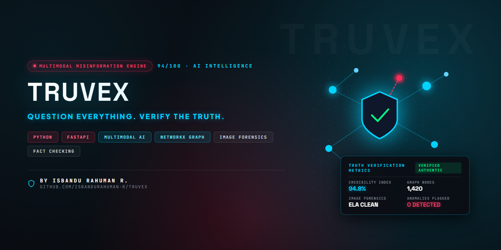
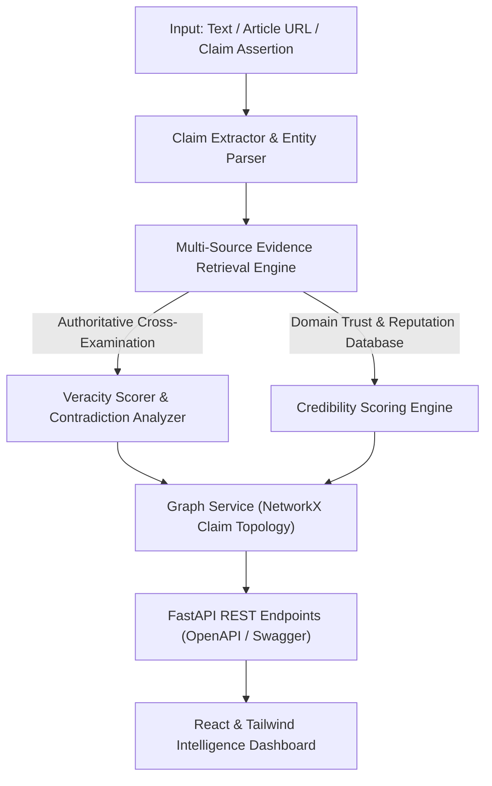

<p align="center">
  
</p>

# ◈ TRUVEX — Multimodal Misinformation Detection Platform

[](https://github.com/ISBANDURAHUMAN-R/TRUVEX/actions)
[](https://www.python.org/)
[](https://fastapi.tiangolo.com)
[](https://opensource.org/licenses/MIT)

## ◆ About the Project
TRUVEX is an AI-powered misinformation detection and claims verification system. It decomposes complex textual and multimodal assertions into testable atomic claims, cross-examines independent authoritative evidence in real time, computes objective veracity ratings, and renders dynamic claim-topology graphs via NetworkX.

## ◆ System Architecture


## ❖ Key Features
- **Atomic Claim Extraction**: Deconstructs paragraphs into independent testable assertions using entity parsing and dependency bounds.
- **Cross-Source Evidence Retrieval**: Queries trusted domain knowledge bases and authoritative indices to extract contradictory or corroborating evidence.
- **Topological Claim Graphs**: Builds directed claim-evidence trees using NetworkX to map propagation paths and logical contradictions.
- **Veracity & Risk Quantification**: Generates calibrated confidence scores (0.0 to 1.0) and automated risk ratings (Verified, Disputed, Unsubstantiated, Fabricated).
- **Interactive Intelligence Dashboard**: React 18, Tailwind CSS, and HTML5 Canvas interface with real-time telemetry meters and history persistence.
- **Enterprise OpenAPI Backend**: Low-latency FastAPI REST API with automated interactive Swagger documentation and parameterized SQLite storage.
- **Automated Test Automation**: Complete automated test suite covering live analysis, status reporting, and edge-case handling.

## ◆ Quickstart & REST API Usage

### 1. Verification via Python
```python
import requests

payload = {
    "text": "Recent reports assert that atmospheric carbon levels decreased by 30% globally this quarter."
}

response = requests.post("http://localhost:8000/api/analyze", json=payload)
data = response.json()

print(f"Veracity Score: {data['veracity_score']}")
print(f"Classification: {data['verdict']}")
print(f"Evidence Sources: {len(data['evidence'])}")
```

### 2. Verification via cURL
```bash
curl -X POST "http://localhost:8000/api/analyze" \
     -H "Content-Type: application/json" \
     -d '{"text": "Sample assertion for veracity verification"}'
```

Interactive API documentation and schema exploration is immediately accessible at `http://localhost:8000/docs` upon server startup.

## ⬢ Technologies Used
- Python 3.11+
- FastAPI & Pydantic
- NetworkX & NumPy
- SQLite & SQLAlchemy
- Docker & Docker Compose
- React 18 & TypeScript
- Tailwind CSS
- pytest

## § Requirements
- Python 3.11 or higher
- Node.js 18 or higher (for frontend build)
- Docker & Docker Compose (optional for containerized deployment)

## ▲ Installation & Execution
```bash
# 1. Setup Virtual Environment & Install Dependencies
python -m venv .venv
source .venv/bin/activate  # On Windows: .venv\Scripts\activate
pip install -r requirements.txt

# 2. Launch Unified Server (Frontend + Backend on Port 8000)
python run.py

# 3. Run Automated Pytest Suite
pytest tests
```

Access the intelligence dashboard in your browser at `http://localhost:8000`.

## ※ Developer
Developer: ISBANDU RAHUMAN R  
GitHub: https://github.com/ISBANDURAHUMAN-R
